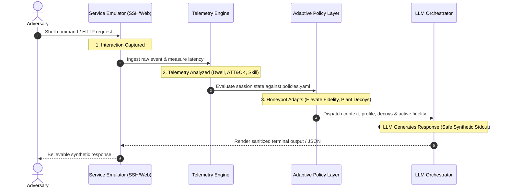

# ChameleonNet: LLM-Powered Adaptive Defensive Honeypot

> **An LLM-Powered Adaptive Honeypot for Realistic Attacker Deception & Telemetry Analytics**  
> Containerized, offline-capable, safety-constrained defensive deception platform.

---

## 1. Executive Overview

**ChameleonNet** emulates interactive production services (SSH terminal shells and corporate web administration portals) using dynamic Large Language Models and role-conditioned system prompts. Rather than serving static, predictable responses that red teams quickly identify and abandon, ChameleonNet analyzes attacker telemetry in real time and adapts its behavior—elevating fidelity, planting synthetic decoys, and extending adversary dwell time by up to **13x**.

### Core Modules
1. **Service Emulators:**
   - **Interactive SSH Emulator (`asyncssh`):** Fake authentication, realistic MOTD banner, session directory navigation, fake command history, and virtual in-memory filesystem. Attacker commands are **never** executed on the host.
   - **Web Admin Emulator (`FastAPI`):** Fake corporate gateway (*ApexCloud Internal Admin Portal v4.2*) with staged login, SQL injection bypass trap, `/admin` dashboard, and dynamic `/api/users` & `/api/config` endpoints.
2. **LLM Orchestrator:**
   - Pluggable provider architecture with a high-fidelity **offline Mock provider** (runs 100% locally with zero external keys) and live **Google Gemini / Claude API** integrations.
   - Role-conditioned profiles: `ubuntu_web_server`, `dev_workstation`, and `database_host`.
   - Stateful session memory preserving working directories, command history, and virtual files.
   - Safety filters scrubbing real PII, blocking prompt injections, and enforcing purely synthetic outputs.
3. **Telemetry Engine:**
   - Real-time ingestion into SQLite with WAL mode.
   - Dynamic dwell-time calculation and MITRE ATT&CK technique classification (T1082, T1033, T1087, T1057, T1016, T1083, T1552, T1548, T1190, T1213).
   - Attacker Skill Scoring algorithm (1.0 to 10.0 scale) based on technique diversity, tool sophistication, and velocity.
4. **Adaptive Policy Layer:**
   - Hot-reloadable rules defined in `policies.yaml`.
   - Dynamically escalates fidelity (`low` $\to$ `medium` $\to$ `high`) and plants decoy breadcrumbs (synthetic AWS keys, staging database configs, VPN configs) upon detecting skilled probing.
   - Strict containment: command rate limits, session timeouts, and egress isolation.
5. **Live Operations Dashboard:**
   - Real-time WebSocket streaming feed with warm cream background and burnt orange accent (`#D2600F`).
   - Closed-loop feedback cycle visualizer (matching Slide 4).
   - Side-by-side **Static Honeypot vs ChameleonNet** benchmark comparison panel.

---

## 2. Closed-Loop Feedback Cycle (Slide 4 Mapping)

ChameleonNet executes the defensive deception feedback cycle on every adversary interaction:



---

## 3. Quickstart & Installation

### Option A: Local Run (Instant, Zero Setup)
```bash
# 1. Clone or navigate to the project directory
cd chameleon-net

# 2. Install dependencies
pip install -r requirements.txt

# 3. Launch all services (SSH on 2222, Web on 8080, Dashboard on 8500)
python main.py
```

### Option B: Docker Compose (Fully Isolated Container)
```bash
# Build and run container with egress isolation
docker-compose up --build
```
> [!NOTE]
> Docker Compose connects ChameleonNet to an internal bridge network (`internal: true`). All egress traffic is blocked at the network driver level.

### Accessing the Services
- **Live Operations Dashboard:** [http://localhost:8500](http://localhost:8500)
- **Web Admin Portal (Honeypot):** [http://localhost:8080](http://localhost:8080)
- **SSH Honeypot Shell:** `ssh -p 2222 admin@localhost` (password: any password)

---

## 4. 3-Minute Demo Walkthrough Script

This script is structured for live presentation mapped directly to the slide deck case studies:

### Case Study 1: "Advanced SSH Recon" (0:00 – 1:30)
1. **Open the Dashboard:** Navigate to [http://localhost:8500](http://localhost:8500) in your browser. Point out the **Closed-Loop Feedback Cycle** indicator and initial metrics.
2. **Trigger the Simulation:** Click the **`▶ Demo: SSH Recon`** button in the top right header (or run `ssh -p 2222 admin@localhost` manually).
3. **Observe Live Adaptation:**
   - **Stage 1 (Initial Access & SysInfo):** Attacker runs `whoami` and `uname -a`. MITRE tags `T1033` and `T1082` light up on the dashboard. Initial fidelity is `medium`.
   - **Stage 2 (Account Enumeration):** Attacker inspects `/etc/passwd`. Telemetry logs `T1087: Account Discovery`.
   - **Stage 3 (Privilege Escalation Attempt):** Attacker attempts `sudo -l` and `find / -perm -4000`. 
   - **The Adaptive Pivot:** The Policy Engine evaluates the elevated skill score ($\ge 6.0$). Notice the live dashboard alert:
     - Fidelity elevates from `medium` $\to$ **`high`**.
     - A synthetic AWS decoy is dynamically planted at `~/.aws/credentials`.
   - **Stage 4 (Decoy Discovery & Enticement):** The adversary runs `cat ~/.aws/credentials`. ChameleonNet outputs realistic synthetic AWS access keys (`AKIAIOSFODNN7...`), keeping the adversary engaged in an isolated breadcrumb trail.

### Case Study 2: "Web App Intrusion" (1:30 – 2:30)
1. **Trigger Web Intrusion:** Click **`▶ Demo: Web Intrusion`** on the dashboard.
2. **Observe the Chain:**
   - Attacker probes the corporate login at `GET /`.
   - Attacker attempts SQL injection bypass (`POST /login` with `admin' OR 1=1--`).
   - The honeypot bypasses to the staged `/admin` dashboard.
   - Attacker accesses `/api/users` and `/api/config`, harvesting synthetic database credentials and cluster endpoints (`T1190`, `T1213`).
   - Dashboard captures all payloads and tags them without exposing real systems.

### Case Study 3: "Static vs ChameleonNet Benchmark" (2:30 – 3:00)
1. **Run the Benchmark:** Click the orange **`⚡ Compare vs Static`** button.
2. **Review the Comparison Panel:**
   - **Static Honeypot:** Fails on command 3 due to missing Linux utilities; adversary aborts after **4.2s** with **0 decoys**.
   - **ChameleonNet:** Completes all 12 commands; adversary persists for **>50s** with **5+ synthetic artifacts captured**.
   - **Outcome:** **12x+ Dwell Time Increase** and **7x Intelligence Gain**.

---

## 5. Verification & Unit Testing

Run the full automated test suite:
```bash
python -m pytest -v
```

The test suite validates:
- **`test_orchestrator.py`**: Mock Linux commands, directory memory tracking, safety filtering, and prompt injection defense.
- **`test_telemetry.py`**: MITRE ATT&CK rule-based tagging, skill scoring formulas, and SQLite event persistence.
- **`test_policy.py`**: Fidelity transitions, dynamic decoy injection, and hot-reloading YAML.
- **`test_emulators.py`**: Web portal routes, SQLi honeypot bypass, and staged API endpoints.

---

## 6. Project Architecture & File Hierarchy

```
chameleon-net/
├── docker-compose.yml       # Container orchestration (internal egress isolation)
├── Dockerfile               # Production container definition
├── requirements.txt         # Core dependencies
├── main.py                  # Supervisor starting SSH, Web, and Dashboard
├── policies.yaml            # Hot-reloadable adaptive policy rules & decoys
├── .env.example             # Configuration template
├── README.md                # Comprehensive guide & 3-min demo script
├── SAFETY.md                # Containment guarantees & red-team test plan
│
├── core/
│   ├── config.py            # Environment & runtime settings
│   ├── models.py            # Pydantic schemas (Event, Session, DecoyItem)
│   ├── safety.py            # Output sanitization, PII scrubbers & injection defense
│   └── pipeline.py          # 4-stage closed-loop feedback pipeline coordinator
│
├── telemetry/
│   ├── database.py          # SQLite WAL connection & queries
│   ├── engine.py            # Ingestion pipeline, dwell-time & skill scorer
│   └── mitre_tags.py        # MITRE ATT&CK technique classifier
│
├── orchestrator/
│   ├── client.py            # Abstract LLMClient interface
│   ├── mock_provider.py     # Realistic offline mock provider (zero API keys needed)
│   ├── gemini_provider.py   # Live Google Gemini API client with fallback
│   ├── prompts.py           # Role-conditioned system prompts & profiles
│   ├── memory.py            # Per-session context memory & virtual file store
│   └── engine.py            # Orchestrator coordinator & safety filtering
│
├── emulators/
│   ├── ssh/
│   │   ├── server.py        # AsyncSSH server daemon with interactive shell
│   │   └── vfs.py           # Virtual filesystem with decoy injection
│   └── web/
│       └── app.py           # FastAPI fake internal admin portal (/login, /admin, /api/*)
│
├── policy/
│   ├── manager.py           # Hot-reloading watcher for policies.yaml
│   └── rules.py             # Adaptive rule evaluator (fidelity escalation, decoys)
│
├── dashboard/
│   ├── api.py               # REST API & WebSocket broadcaster
│   └── static/
│       ├── index.html       # UI (Warm cream & #D2600F orange accent)
│       ├── styles.css       # Design tokens & responsive styling
│       └── app.js           # WebSocket feeds, Chart.js & benchmark runner
│
├── simulator/
│   ├── attacker_sim.py      # Automated benign attacker for live demo
│   └── benchmark.py         # Comparative benchmark: Static vs ChameleonNet
│
└── tests/
    ├── test_orchestrator.py # Orchestrator unit tests
    ├── test_telemetry.py    # Telemetry & skill score unit tests
    ├── test_policy.py       # Policy & decoy unit tests
    └── test_emulators.py    # Web emulator unit tests
```

---

## 7. Safety, Containment & Ethics

Please refer to [SAFETY.md](file:///C:/Users/Sri%20Balaji/.gemini/antigravity-ide/scratch/chameleon-net/SAFETY.md) for full details on:
- Host isolation guarantees (zero execution of attacker inputs).
- Network egress prohibition.
- 100% synthetic credential generation.
- The 4-phase Red-Team Validation Plan.
